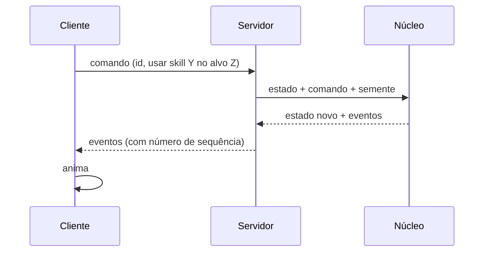
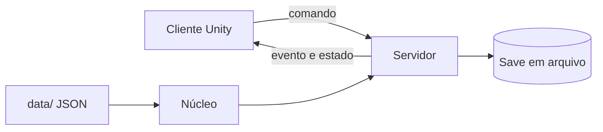
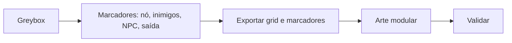

# Técnico

Como o jogo é montado por dentro. A ordem de trabalho está em [04-roteiro](04-roteiro.md).

## Regras

- Só PC (Steam).
- Servidor autoritativo: o cliente pede, o servidor decide.
- Núcleo de regras separado da engine: roda sem tela, em teste e no servidor.
- Conteúdo em dados (JSON em `data/`), não no código.
- Nada roda offline: o automático só existe com o cliente conectado.

## Núcleo

`aplicar(estado, ação, semente) → (estado, eventos)`

- Nada que muda fica guardado fora do `estado`.
- O estado é dado puro: sem métodos, sem `map` e sem ponteiro compartilhado.
- Não mexe no estado que entrou: copia ou monta um novo.
- Só inteiros. Semente e contador do sorteio ficam dentro do estado. Sem relógio do sistema.
- Ver [Motor de regras](mecanicas/motor-de-regras.md).

## Uma ação, do clique à tela

## Partes

| Parte | Faz | Não faz |
|---|---|---|
| Núcleo | Regras: d20, combate, durabilidade, progressão | Rede, tela, arquivo |
| Servidor | Dono do mundo; roda lutas e o automático do jogador conectado | Desenhar |
| Cliente | Envia comando, anima evento, monta o personagem pelo equipamento | Decidir resultado |

- Combate é instância: usa o cenário do lugar; no mapa aparece o personagem parado com o ícone de luta.
- Log de luta guarda a versão das regras e o hash de `data/`.

## Stack

| Parte | Escolha |
|---|---|
| Núcleo, simulador e servidor | Go |
| Cliente | Unity (C#), fino; entra depois da luta no terminal |
| Rede | WebSocket + JSON, um processo, sem framework |
| Até um amigo jogar | Servidor local junto do cliente; save em arquivo |
| Depois | VPS, PostgreSQL, login Steamworks |
| Navegador | Só playground (cliente WebSocket do servidor local) |

- Contrato de mensagens desde a noite 1: comando com id; evento com número de sequência.

## Repositório

| Pasta | Conteúdo |
|---|---|
| `regras/` | Núcleo |
| `contrato/` | Mensagens entre cliente e servidor |
| `sim/` | Simulador de console |
| `server/` | Servidor |
| `client/` | Projeto Unity |
| `data/` | JSON de conteúdo |
| `docs/` | Esta documentação |

- Git LFS desde o início para modelo, textura e áudio. Unity LTS.

## Propostas

**Montagem de mapas**

- Fixo na cena: terreno e construções. Enviado pelo servidor: nós, inimigos, NPCs, jogadores.
- Tutorial como máquina de estados em dado.

## Em aberto

- Ordem fixa para efeitos simultâneos.
- Modelo dos eventos em Go: struct achatada ou interface com tipo.
