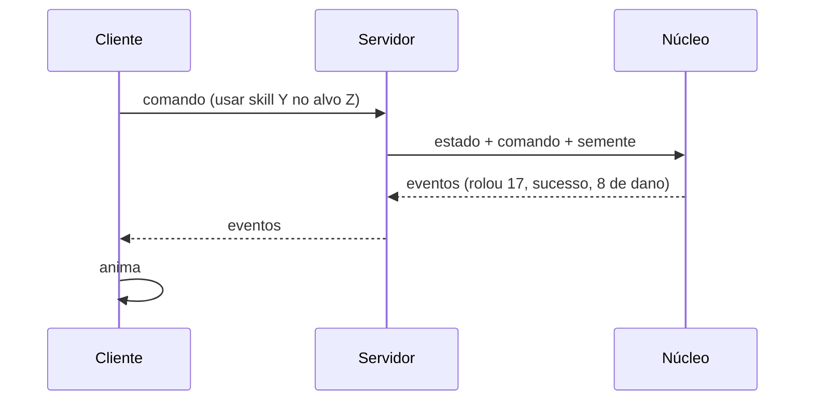
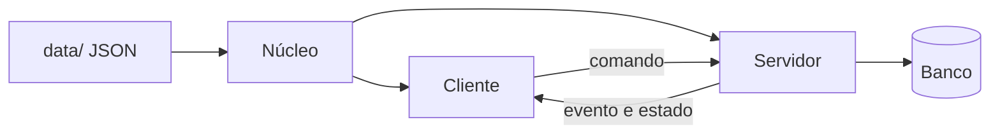
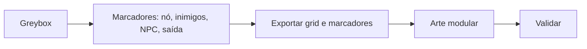

# Técnico

Como o jogo é montado por dentro. A ordem de trabalho está em [04-roteiro](04-roteiro.md).

## Regras

- Só PC (Steam).
- Servidor autoritativo: o cliente pede, o servidor decide.
- Núcleo de regras separado da engine: roda sem tela, em teste e no servidor.
- Determinismo: semente por luta, contas em inteiros, sem relógio do sistema. Ver [Motor de regras](mecanicas/motor-de-regras.md).
- Conteúdo em dados (JSON em `data/`), não no código.

## Uma ação, do clique à tela

## Partes

| Parte | Faz | Não faz |
|---|---|---|
| Núcleo | Regras: d20, combate, durabilidade, progressão | Rede, tela, banco |
| Servidor | Dono do mundo; roda lutas, inclusive sem cliente (automático) | Desenhar |
| Cliente | Envia comando, anima evento, monta o personagem pelo equipamento | Decidir resultado |

## Propostas

**Stack**

| Parte | Escolha |
|---|---|
| Cliente | Unity (C#), 3D low poly, câmera fixa inclinada |
| Servidor | .NET (C#), PostgreSQL |
| Núcleo | C# puro (.NET Standard 2.1), pacote local no Unity |
| Login | Steamworks |

**Rede**
- MVP: WebSocket ou TCP com JSON. Depois: UDP (LiteNetLib) e binário.
- Mensagens: comando (cliente → servidor), evento e estado (servidor → cliente).
- Transporte atrás de uma camada própria. Servidor só manda o que está perto do jogador.

**Repositório**

| Pasta | Conteúdo |
|---|---|
| `core/` | Núcleo de regras |
| `sim/` | Simulador de console |
| `tests/` | Testes do núcleo |
| `server/` | Servidor |
| `client/` | Projeto Unity |
| `data/` | JSON de conteúdo |
| `tools/` | Exportador de mapas |
| `docs/` | Esta documentação |

- Git LFS desde o início para modelo, textura e áudio. Unity LTS.

**Montagem de mapas**

- Fixo na cena: terreno e construções. Enviado pelo servidor: nós, inimigos, NPCs, jogadores.
- Tutorial como máquina de estados em dado.

## Em aberto

- Confirmar a stack (Unity + .NET).
- Ordem fixa para efeitos simultâneos.
