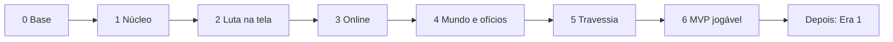
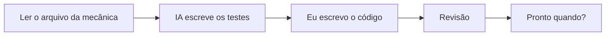

# Roteiro

Do zero ao MVP, em fases. Cada fase junta técnico, cliente, dados e escrita. O que fazer em cada uma: [04-roteiro.canvas](04-roteiro.canvas).

## Fases

| Fase | Pronto quando |
|---|---|
| 0 Base | Stack confirmada; motor, combate e personagem validados; repositório criado |
| 1 Núcleo | O simulador roda 1.000 lutas sozinho e a mesma semente repete a mesma luta |
| 2 Luta na tela | Luto no manual e no automático numa arena; trocar equipamento muda visual, skills e atributos |
| 3 Online | A luta roda no servidor; faço login, saio e volto com tudo salvo |
| 4 Mundo e ofícios | Na Beira em greybox: ando, a luta abre no lugar, coleto, refino, crafto e conserto |
| 5 Travessia | Jogo os 20 passos do começo ao fim |
| 6 MVP jogável | Um amigo joga a Travessia sem eu explicar nada |

## Regras

- Uma fase por vez. Técnico puxa; cliente, dados e escrita acompanham.
- Valido o doc só quando a fase vai usar.
- Cliente com placeholder até a fase 6.
- Dados mínimos: só o que a fase testa.
- Mecânica sem decisão trava a fase: decido antes de codar.
- Fase pronta: cards verdes no canvas.

## Como trabalhar

- Referência da IA num repositório separado; fecho antes de escrever.
- No Unity: a referência vale mais (API e editor).

## Em aberto

- Quanto tempo cada fase leva (medir na fase 1).
