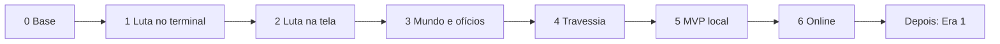
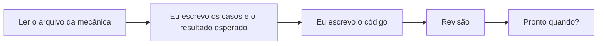

# Roteiro

Do zero ao MVP, em fases. Cada fase junta técnico, cliente, dados e escrita. O que fazer em cada uma: [04-roteiro.canvas](04-roteiro.canvas). Tarefas da fase em curso: [fase-atual](fase-atual.md).

## Fases

**Fase em curso:** 1 Luta no terminal

| Fase | Orçamento (sessões) | Pronto quando |
|---|---|---|
| 0 Base | 4 | Docs validados e congelados; pastas separadas; automações ativas |
| 1 Luta no terminal | 20 | 1 personagem × 2 mobs no terminal; a mesma semente repete a luta; o simulador roda 1.000 lutas. Marcos nas sessões 5, 10 e 20 |
| 2 Luta na tela | medir na fase 1 | Luto no manual e no automático numa arena no Unity; trocar equipamento muda visual, skills e atributos |
| 3 Mundo e ofícios | medir na fase 1 | Na Beira em greybox, local, com save em arquivo: ando, a luta abre, coleto, refino, crafto e conserto |
| 4 Travessia | medir na fase 1 | Jogo os 15 passos do começo ao fim |
| 5 MVP local | medir na fase 1 | Um amigo joga a Travessia sem eu explicar nada |
| 6 Online | medir na fase 1 | Rede, login Steam e banco; saio e volto com tudo salvo |

## Regras

- Uma fase por vez. Técnico puxa; cliente, dados e escrita acompanham.
- Sessão = 30 minutos ou mais de trabalho, em qualquer horário. Registro em [sessoes](sessoes.md).
- Cada fase tem orçamento de sessões. Estourou 1,5×: corta escopo, nunca troca de stack.
- A stack só se rediscute com a fase em curso jogável.
- Ideia fora da fase vai para o [estacionamento](estacionamento.md).
- Cliente com placeholder até a fase 5.
- Dados mínimos: só o que a fase testa.
- Mecânica sem decisão trava a fase: decido antes de codar.
- Página da Steam só depois do teste de arte (3 Sidekicks no grid, 1 sessão).
- Fase pronta: todas as tarefas de [fase-atual](fase-atual.md) marcadas e "Pronto quando" cumprido. Aí troco a "Fase em curso".

## Como trabalhar

- A IA escreve só o laço que roda a tabela de casos.
- A IA pode no simulador, em scripts e em testes de rede. Nunca na regra nem no que o jogador vê.

## Em aberto

- Orçamento de sessões das fases 2 a 6 (medir na fase 1).
