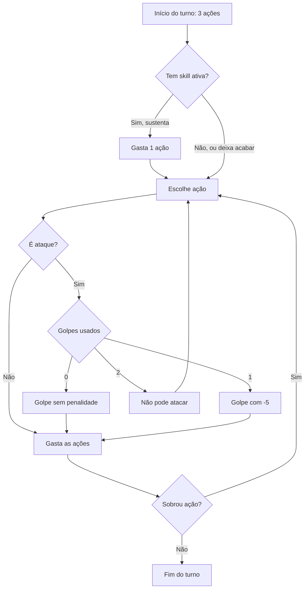

# Combate

Lutas por turno num grid visível, em instância. O mesmo motor serve para jogador, inimigos, automático e eco.

## Turno

- Turno por lado: o seu lado age, depois o lado inimigo.
- 3 ações + 1 reação por rodada.
- Golpe = qualquer teste de ataque contra a Defesa (ataque básico ou skill de ataque). No máximo 2 golpes por turno; o 2º com -5.
- Skills custam 1, 2 ou 3 ações. Skill de ataque conta como 1 golpe, não importa o custo.
- Andar custa ação.
- Skill que fica ativa (ex.: aura, escudo) gasta 1 ação por turno para continuar (sustentar); se não gastar, acaba. Sustentar não é golpe.
- Inimigo: até 4 ações por rodada, animadas juntas em até 2 s. A intenção dele aparece antes (casa-alvo).
- Velocidade 2x/3x e pular o turno inimigo.
- Acerto base calibrado jogando no terminal.
- Ataque básico é uma skill da arma: 1 ação, 1 golpe.
- Acerto: 1d20 + modificador de acerto da skill contra a Defesa do alvo.
- Dano por skill em dado (ex.: 1d8+2), com prévia da faixa na tela. Só rola dano se acertou. Sucesso crítico dobra o total.

**Turnos possíveis com 3 ações**

| Turno                                                                       | Ações     | Golpes | Penalidade         |
| --------------------------------------------------------------------------- | --------- | ------ | ------------------ |
| Golpe + golpe + tática (andar, Passo, defender, skill sem ataque de 1 ação) | 1 + 1 + 1 | 2      | 2º com -5          |
| Andar + golpe + golpe                                                       | 1 + 1 + 1 | 2      | 2º com -5          |
| Skill de ataque de 2 ações + golpe                                          | 2 + 1     | 2      | golpe com -5       |
| Golpe + skill de ataque de 2 ações                                          | 1 + 2     | 2      | skill com -5       |
| Skill de ataque de 2 ações + tática                                         | 2 + 1     | 1      | —                  |
| Skill de ataque de 3 ações                                                  | 3         | 1      | —                  |
| Golpe + skill sem ataque de 2 ações (cura, defesa)                          | 1 + 2     | 1      | —                  |
| Skill sem ataque de 2 ações + golpe                                         | 2 + 1     | 1      | —                  |
| Andar + andar + golpe                                                       | 1 + 1 + 1 | 1      | —                  |
| Skill sem ataque de 3 ações                                                 | 3         | 0      | —                  |
| Sustentar + golpe + golpe                                                   | 1 + 1 + 1 | 2      | 2º com -5          |
| Sustentar + skill de ataque de 2 ações                                      | 1 + 2     | 1      | —                  |
| Sustentar + andar + golpe                                                   | 1 + 1 + 1 | 1      | —                  |
| Sustentar + andar + andar                                                   | 1 + 1 + 1 | 0      | —                  |
| Sustentar 2 skills ativas + golpe                                           | 1 + 1 + 1 | 1      | —                  |
| Andar + andar + andar (fugir)                                               | 1 + 1 + 1 | 0      | —                  |
| Golpe + golpe + golpe                                                       | —         | —      | Não pode: 3º golpe |
| Skill de ataque de 2 ações + skill de ataque de 1 ação, depois de um golpe  | —         | —      | Não pode: 3º golpe |

## Condições

Bônus fixo de circunstância: +2 ou -2 no teste ou na Defesa. Do mesmo tipo não se somam; vale o maior.

| Condição     | Quando                                        | Efeito                                             |
| ------------ | --------------------------------------------- | -------------------------------------------------- |
| Flanqueado   | Dois inimigos adjacentes em lados opostos     | -2 na Defesa                                       |
| Caído        | Derrubado por skill                           | -2 no ataque e -2 na Defesa; levantar custa 1 ação |
| Defendendo   | Usou a ação defender                          | +2 na Defesa até o próximo turno                   |
| Em cobertura | Atrás de obstáculo, contra ataque à distância | +2 na Defesa                                       |

| Exemplo            | Resultado                       |
| ------------------ | ------------------------------- |
| Flanqueado e caído | Defesa -2 (não soma), ataque -2 |
| Caído e defendendo | Defesa 0 (-2 e +2), ataque -2   |

## Entrada na luta

- Grupo de inimigos visível no mapa; encostar abre a luta em instância, com o cenário do lugar.
- No mapa, quem passa vê o personagem parado ao lado dos mobs, com o ícone de luta.
- O mob ganha uma cópia por jogador: ninguém trava o grupo para os outros.
- Antes da luta no manual, a tela mostra o risco.
- A luta manual pausa sem limite.

## Movimento

- Casas por ação = 5 − (peso total ÷ 3), arredondado para baixo. Peso por peça: pano 0, couro 1, placa 2. Calibrar no simulador.
- Ataque de oportunidade é reação e vem do item (campo no JSON); nem todo item tem.
- Passo: 1 casa, sem provocar ataque de oportunidade.
- Ranged pode atacar colado, com penalidade, e provoca ataque de oportunidade.
- Ninguém termina no mesmo quadrado. Atravessa aliado; inimigo só com skill ou manobra.
- Sair da borda só por skill.
- Se o simulador medir mais de 60% de turnos "anda + bate + bate": testar o Passo grátis 1 vez por turno.

**Velocidade pelas peças (capacete, peitoral, botas)**

| Peso total | Exemplos                                | Casas por ação |
| ---------- | --------------------------------------- | -------------- |
| 0          | Tudo pano                               | 5              |
| 1          | 1 couro + 2 pano                        | 5              |
| 2          | 2 couro + 1 pano · 1 placa + 2 pano     | 5              |
| 3          | Tudo couro · 1 placa + 1 couro + 1 pano | 4              |
| 4          | 2 placa + 1 pano · 1 placa + 2 couro    | 4              |
| 5          | 2 placa + 1 couro                       | 4              |
| 6          | Tudo placa                              | 3              |

## Modos

| Modo       | Como funciona                                                                                                  | Rende              | Onde                     |
| ---------- | -------------------------------------------------------------------------------------------------------------- | ------------------ | ------------------------ |
| Manual     | O jogador decide cada ação                                                                                     | Mais               | Chefes e jornadas exigem |
| Automático | Lista de prioridade + intenção de movimento; só com o jogo aberto; para por recurso (inventário, durabilidade) | Menos que o manual | Farm, caçada             |

- A IA dos inimigos usa o mesmo decisor do automático.

## PvP contra eco _(adiado)_

- Eco: cópia da build e da automação de outro jogador. Sem perda de itens.
- Primeiro os dois lados no automático; depois, manual contra o eco.

## Em Aberto
- Onde cada lado nasce na arena (fase 1: arena fixa em data/?).
- HP: de onde vem e quanto vale no T1.