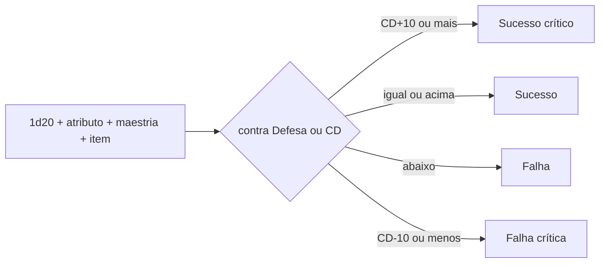

# Motor de regras

Como toda ação com chance de sucesso é resolvida: ataque, coleta, craft e conversa.

## Fluxo

## Regras

- 20 natural sobe um grau; 1 natural desce um grau.
- O grau não passa dos extremos: 20 natural em sucesso crítico continua crítico; 1 natural em falha crítica continua falha crítica.
- Modificador = soma dos bônus e penalidades já aplicada (é o número que o código guarda).
- Os mesmos graus valem para coleta e craft.
- Bônus fixos, sem vantagem/desvantagem.
- Tipos de bônus: item, circunstância, status. Do mesmo tipo não se somam; vale o maior.
- Determinismo: gerador com semente por luta, contas em inteiros, nada de relógio do sistema. A semente e o contador do sorteio ficam dentro do estado. Reproduzir = semente + estado inicial + decisões.
- Ordem de efeitos simultâneos:
  1. Reação resolve antes da ação que a disparou.
  2. No mesmo lado, segue a ordem da lista (ordem de entrada na luta).
  3. Efeitos de início e fim de turno: do mais antigo para o mais novo.

## Bônus de acerto

| Fonte             | Faixa            |
| ----------------- | ---------------- |
| Atributo          | 0 a +4           |
| Maestria da linha | +1 a +4          |
| Item (tier)       | 0 a +3           |
| **Total no topo** | **cerca de +10** |

## Defesa e CD

CD padrão do tier = 8 + bônus esperado do tier. Cada tier de diferença vale ±2.

| Tier | Bônus esperado | Defesa do mob e CD do nó | Acerto |
| ---- | -------------- | ------------------------ | ------ |
| T1   | +2             | 10                       | 65%    |
| T2   | +3             | 11                       | 65%    |
| T3   | +5             | 13                       | 65%    |
| T4   | +6             | 14                       | 65%    |

- Números iniciais: o simulador ajusta.
- O mob ataca com a conta inversa: bônus do mob = Defesa típica do jogador no tier − 8.