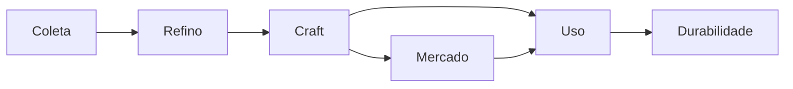

# Ofícios e economia

Como os recursos entram, viram equipamento e saem do jogo. Regras de tier seguem o Albion. Progressão dos ofícios: ver [Personagem](personagem.md).

## Ciclo

## Coleta

- Um teste de d20 por nó (Sabedoria Ancestral). O grau decide quanto o nó rende.
- T1 (pedra, madeira) se coleta sem ferramenta.
- Ferramentas: machado (madeira), picareta (minério e pedra), foice (fibra), faca (couro).
- A ferramenta coleta até 1 tier acima dela (machado T3 corta madeira T4).
- Coleta automática usa o mesmo teste, só com o jogo aberto. Para com o inventário cheio ou a ferramenta sem durabilidade.

## Refino

- Teste de d20 (Conhecimento). Bruto vira refinado: tábua, couro curtido, pano, barra.
- Receita segue o Albion (bruto do tier + refinado do tier anterior).

## Craft

- Teste de d20 (Conhecimento).
- Peça de facção: afinidade com o mestre artesão da facção + artefato.

## Carga

- Inventário existe sem bolsa.
- Bolsa: craftada; como no Albion, aumenta a capacidade de peso e dá status.
- Montaria: comprada; carga e velocidade.

## Mercado

- Comércio entre jogadores.
- Comprador NPC com piso sugerido.

## Propostas

| Grau | Coleta (nó de 5) | Refino | Craft |
|---|---|---|---|
| Sucesso crítico | 7 | Devolve parte do bruto | Qualidade acima |
| Sucesso | 5 | Produz | Produz |
| Falha | 3 | Não produz, sem perda | Não produz |
| Falha crítica | 3, ferramenta gasta mais | Não produz, sem perda de material | Não produz, sem perda de material |

- Qualidade em 5 níveis.
- Recompensas de jornada e contrato fora do mercado.

## Em aberto

- Números da receita de refino (confirmar no Albion).
- Carga: capacidade, peso, bônus da bolsa e da montaria.
- O que a montaria muda: velocidade, carga ou as duas.
