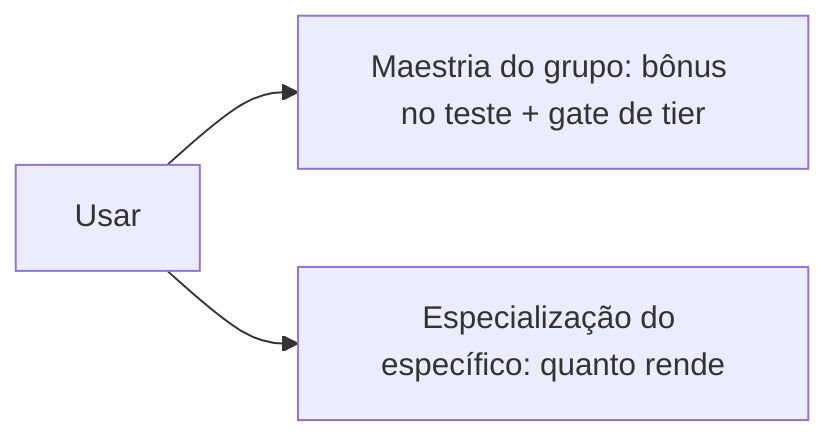

# Personagem

Você é o que veste: skills, passivas e atributos vêm do equipamento. Sem nível de personagem; a progressão é por uso.

## Build

- Sem classes. Skills na arma e na armadura; passivas escolhíveis no item.
- Material da armadura (pano, couro, placa) define defesa, deslocamento e grupo de passivas.
- Off-hand desde o T1. Arma de uma mão libera o off-hand; arma de duas mãos ocupa as duas (como o Albion).
- Sem gemas. Sem encantamento no início.
- Arma: Q, W e passiva vêm do pool da família (todas as espadas compartilham); o E é único de cada arma. No T1, só o Q, com 2 opções; do T2 em diante, Q, W, E e passiva (como o Albion).
- Armadura: cada peça tem 1 slot de ativa e, do T2 em diante, 1 slot de passiva. Opções por slot: 1 no T1, 2 no T2, 3 do T3 em diante. A 1ª ativa de cada peça é a mesma em todos os materiais (a do T1).
- Peitoral de placa: um 2º slot de passiva, com 2 opções, do T2 em diante.
- Off-hand: sem skill e sem passiva; dá só números.
- T1 não tem marco de maestria: qualquer um usa (como o Albion, onde o painel do destino começa no T2).

## Atributos

Vêm só do equipamento.

| Atributo | Papel |
|---|---|
| Força Bruta | Acerto e dano corpo a corpo pesado |
| Astúcia | Acerto à distância e armas leves, Defesa, iniciativa |
| Vigor | Vida, resistir a veneno e doença |
| Conhecimento | Magia elemental e técnica, craft, refino |
| Sabedoria Ancestral | Magia espiritual, percepção, coleta |
| Presença | Resistência mental, provocação, magia mental, testes sociais |

- Só modificador: sem equipamento, tudo vale 0; as peças somam até +4 (como o PF2e).
- O peso da armadura (o mesmo da velocidade: placa 2, couro 1, pano 0 por peça) soma no HP. O Vigor é um atributo normal, de 0 a +4.
- HP = base + (peso + Vigor) × k. Sem nível. Tudo pano sem Vigor fica com ~55% do HP de tudo placa; base e k saem do simulador.

## Progressão: duas escadas

| Linha | Maestria (grupo) | Especialização (específico) | Especialização dá |
|---|---|---|---|
| Combate | Linha de arma ou armadura | Item | Dano |
| Coleta | Tipo de recurso | Recurso de um tier | Unidades por nó |
| Refino | Material refinado | Material de um tier | Chance de devolver bruto |
| Craft | Família de item | Item | Menos material |

- Maestria: +1 a +4 no teste, em degraus.
- Gate de tier pela maestria: um marco por tier do T2 ao T8, 7 marcos (como o Albion). A interface só mostra os marcos dos tiers que existem no jogo (Era 1: até T4).
- Sem bônus cruzado: especializar um item não ajuda outro.
- O tier do item dá bônus de item, atributos e passivas melhores.

## Descanso

Bônus para quem ficou fora. Nada é produzido offline.

| Regra | Valor |
|---|---|
| Começa a contar | Depois de 4h deslogado, em qualquer lugar |
| Acumula | 1 noite de bônus a cada 20h fora |
| 1 noite de bônus | Pontos que se ganham em 2h de jogo manual |
| Efeito | Dobra o ganho das duas escadas, só em ação manual |
| Gasto | Em pontos, como o rested XP do WoW (a pausa não gasta) |
| Saída de novo | O que sobrou fica; o novo tempo fora soma |
| Teto | 3 noites |

- Saídas de menos de 4h não somam descanso e não gastam o que você tem.

## Propostas

| Libera | Maestria (0–100) | Bônus no teste |
|---|---|---|
| T1 | 0 | +1 |
| T2 | 10 | +1 |
| T3 | 20 | +2 |
| T4 | 35 | +2 |
| T5 | 50 | +3 |
| T6 | 65 | +3 |
| T7 | 80 | +4 |
| T8 | 90 | +4 |

- Curva lenta: cada degrau pede bem mais que o anterior.
- Especialização (0–100): +1 a cada 20 níveis (dano, unidade, retorno ou economia de material).
- Pontos de aprendizado (como os Learning Points do Albion): ganhos por desafio diário, gastos para adiantar qualquer escada. Ajuda quem tem pouco tempo.
- Atributo por peça: arma = ofensivo da linha; peitoral = do material; capacete = Presença ou Sabedoria Ancestral; botas = Astúcia.
- Defesa = 10 + Astúcia + armadura.

## Em aberto

- Um atributo por peça ou principal + secundário.
- Papel da Presença.
