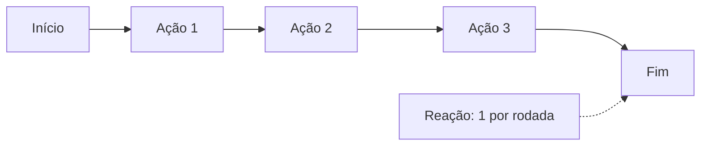

# Combate

Lutas por turno num grid visível. O mesmo motor serve para jogador, inimigos, automático e eco.

## Turno

- 3 ações + 1 reação. Penalidade de ataque múltiplo: -5 no 2º, -10 no 3º.
- Andar custa ação. Skills custam 1, 2 ou 3 ações.

## Entrada na luta

- Grupo de inimigos visível no mapa; encostar abre a luta no próprio lugar.
- Antes da luta no manual, a tela mostra o risco.

## Movimento

- A armadura define quantas casas se anda por ação.
- Ataque de oportunidade é reação. Passo: 1 casa, sem provocar.
- Ranged pode atacar colado, com penalidade, e provoca ataque de oportunidade.
- Ninguém termina no mesmo quadrado. Atravessa aliado; inimigo só com skill ou manobra.
- Sair da borda só por skill.

## Modos

| Modo | Como funciona | Rende | Onde |
|---|---|---|---|
| Manual | O jogador decide cada ação | Mais por luta | Chefes e jornadas exigem |
| Automático | Lista de prioridade + intenção de movimento | Mais por hora | Farm, caçada |
| Contínuo | Mesmos turnos sem pausa | — | Só apresentação |

- A IA dos inimigos usa o mesmo decisor do automático.

## PvP contra eco _(adiado)_

- Eco: cópia da build e da automação de outro jogador. Sem perda de itens.
- Primeiro os dois lados no automático; depois, manual contra o eco.

## Propostas

- O servidor recorta o grid ao redor do encontro e usa como arena.
- Condições do livro antigo com +2/-2 no lugar de vantagem.
- Concentração igual à ação de sustentar do Pathfinder 2e.

## Em aberto

- Ataque de oportunidade para todos ou só certos itens.
- Teto de diferença de velocidade entre armaduras.
- Skills de 2 e 3 ações.
- PvP: recompensa, defensor, pareamento.
