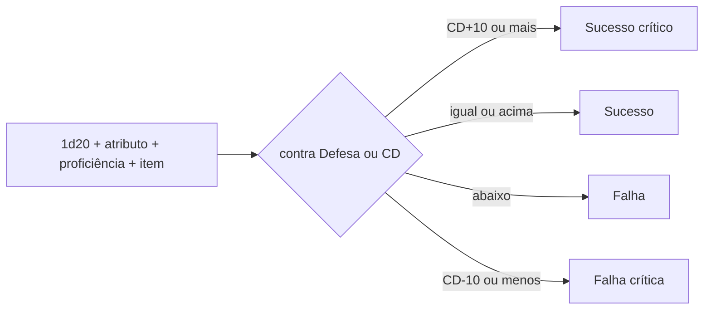

# Motor de regras

Como toda ação com chance de sucesso é resolvida: ataque, coleta, craft e conversa.

## Fluxo

## Regras

- 20 natural sobe um grau; 1 natural desce um grau.
- Os mesmos graus valem para coleta e craft.
- Bônus fixos, sem vantagem/desvantagem.
- Tipos de bônus: item, circunstância, status. Do mesmo tipo não se somam; vale o maior.
- Determinismo: gerador com semente por luta, contas em inteiros, nada de relógio do sistema. Reproduzir = semente + estado inicial + decisões.

## Propostas

| Fonte de bônus de acerto | Faixa |
|---|---|
| Atributo | 0 a +4 |
| Maestria da linha | +1 a +4 |
| Item (tier) | 0 a +3 |
| **Total no topo** | **cerca de +10** |

- Defesas e CDs entre 10 e cerca de 25.

## Em aberto

- Ordem fixa para efeitos simultâneos.
- Balanceamento de CDs e Defesas.
