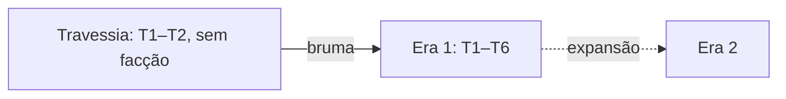

# Mundo

Zonas ligadas por saídas. Facções controlam zonas, eventos deixam marcas, NPCs dão vida.

## Estrutura

- Zona é a unidade: recursos, inimigos, NPCs, facção e saídas.

## Eras e facções

- Toda Era tem no mínimo 2 facções em disputa.
- Facção controla zona; algumas zonas são divididas.
- NPCs reagem ao que você veste (peças de facção da mesma Era).
- Eras são expansões: enredo novo e progressão horizontal.
- Cada peça nova é melhor em alguma situação, não em geral.

## Eventos

- Periódicos, com marca permanente.

## NPCs

| Tipo | Faz | Onde |
|---|---|---|
| De vila | Comércio, tutor de estação, tarefas | Vilas e acampamento |
| Viajante | Leva e traz fofoca entre zonas da mesma Era | Dentro de uma Era |
| Mestre artesão | Afinidade libera receitas de facção | Eras |

## Jornada

- Na Travessia: tarefas, contratos e o tutorial. Sem diário e sem desafio periódico.

## Propostas

- Zona com duas camadas: visual (cena do Unity) e lógica (JSON).
- Grid lógico em toda zona: andar, altura, linha de visão.
- NPCs no MVP: agenda simples + rumores lidos do servidor. Depois: afinidade, reação à roupa.
- Jornada em camadas: progressão, diário, contratos, jornadas escritas, desafio periódico.
- Contratos gerados de modelos; cumprir sobe afinidade; caça funciona no automático.
- Escolhas afetam só o próprio jogador.

## Em aberto

- Arena no lugar do encontro ou fixa por bioma.
- Zonas da Era 1.
