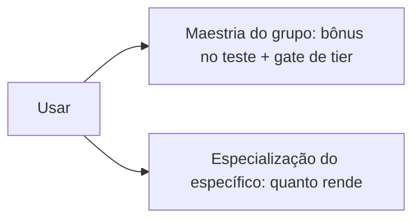

# Personagem

Você é o que veste: skills, passivas e atributos vêm do equipamento. Sem nível de personagem; a progressão é por uso.

## Build

- Sem classes. Skills na arma e na armadura; passivas escolhíveis no item.
- Material da armadura (pano, couro, placa) define defesa, deslocamento e grupo de passivas.
- Off-hand desde o T1. Arma de uma mão libera o off-hand; arma de duas mãos ocupa as duas (como o Albion).
- Sem gemas. Sem encantamento no início.

## Atributos

Vêm só do equipamento.

| Atributo | Papel |
|---|---|
| Força Bruta | Acerto e dano corpo a corpo pesado |
| Astúcia | Acerto à distância e armas leves, Defesa, iniciativa |
| Vigor | Vida, resistir a veneno e doença |
| Conhecimento | Magia elemental e técnica, craft, refino |
| Sabedoria Ancestral | Magia espiritual, percepção, coleta |
| Presença | Resistência mental, provocação, magia mental, testes sociais |

## Progressão: duas escadas

| Linha | Maestria (grupo) | Especialização (específico) | Especialização dá |
|---|---|---|---|
| Combate | Linha de arma ou armadura | Item | Dano |
| Coleta | Tipo de recurso | Recurso de um tier | Unidades por nó |
| Refino | Material refinado | Material de um tier | Chance de devolver bruto |
| Craft | Família de item | Item | Menos material |

- Maestria: +1 a +4 no teste, em degraus.
- Gate de tier pela maestria: um marco por tier, 8 marcos (como o Albion).
- Sem bônus cruzado: especializar um item não ajuda outro.
- O tier do item dá bônus de item, atributos e passivas melhores.

## Propostas

| Libera | Maestria (0–100) | Bônus no teste |
|---|---|---|
| T1 | 0 | +1 |
| T2 | 10 | +1 |
| T3 | 20 | +2 |
| T4 | 35 | +2 |
| T5 | 50 | +3 |
| T6 | 65 | +3 |
| T7 | 80 | +4 |
| T8 | 90 | +4 |

- Curva lenta: cada degrau pede bem mais que o anterior.
- Especialização (0–100): +1 a cada 20 níveis (dano, unidade, retorno ou economia de material).
- Pontos de aprendizado (como os Learning Points do Albion): ganhos por desafio diário, gastos para adiantar qualquer escada. Ajuda quem tem pouco tempo.
- Atributo por peça: arma = ofensivo da linha; peitoral = do material; capacete = Presença ou Sabedoria Ancestral; botas = Astúcia.
- Escala: sem equipamento tudo em 3 (mod 0); itens somam até 6 (+3). Defesa = 10 + Astúcia + armadura.

## Em aberto

- Base sem equipamento: 3 ou 0.
- Um atributo por peça ou principal + secundário.
- Papel da Presença.
- Quantas skills por arma; armas do mesmo grupo compartilham skills?
