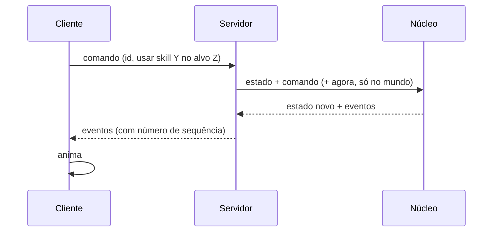
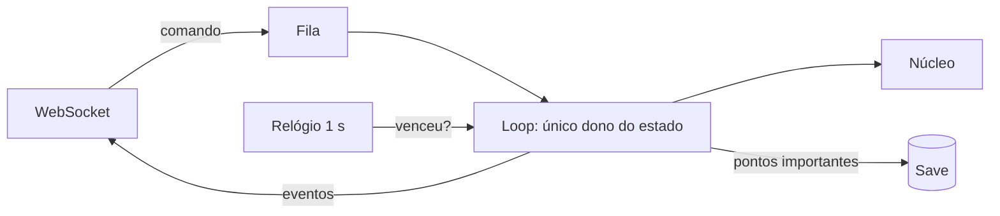
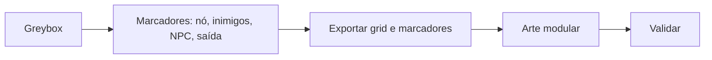

# Técnico

Como o jogo é montado por dentro. A ordem de trabalho está em [04-roteiro](../gestao/04-roteiro.md).

## Regras

- Só PC (Steam).
- Servidor autoritativo: o cliente pede, o servidor decide.
- Núcleo de regras separado da engine: roda sem tela, em teste e no servidor.
- Conteúdo em dados (JSON em `data/`), não no código.
- Nada roda offline: o automático só existe com o cliente conectado.

## Núcleo

`ResolveCombatAction(combat, ação) → (combat, eventos)`

- Nada que muda fica guardado fora do `estado`.
- O estado é dado puro: sem métodos, sem `map` e sem ponteiro compartilhado.
- Não mexe no estado que entrou: copia ou monta um novo.
- Só inteiros. Semente e contador do sorteio ficam dentro do estado. O tempo entra como `agora`; nunca se lê o relógio.
- O combate não recebe `agora`: é por turno. O `agora` é só das ações do mundo.
- Ação de combate: interface `CombatAction` com `resolve(combat) (combat, eventos)`; uma struct por ação (ex.: `UseSkill`), cada uma com o seu `resolve`.
- Porta: `ResolveCombatAction` em `combat.go`. Valida o que vale para toda ação (vez do lado, ações restantes, ator vivo) e chama o `resolve`. Ações do mundo terão a própria porta na fase 3.
- Arquivos: `combat.go` (porta, ações e regras de luta: `rollToHit`, `rollDamage`), `dice.go` (dados e graus).
- Fighter guarda números prontos (HP, Defesa, skills com modificadores). A conta de equipamento → números é outra função. Mob e jogador usam o mesmo Fighter.
- Seed: uma por luta. Quem cria a luta sorteia (`crypto/rand`); cada dado soma 1 no counter; nunca vai para o cliente; não é ID da luta.
- Ver [Motor de regras](../jogo/mecanicas/motor-de-regras.md).

## Tempo

| Onde    | Como passa o tempo                                                                         |
| ------- | ------------------------------------------------------------------------------------------ |
| Combate | Por turno. Sem relógio                                                                     |
| Mundo   | Ação com início e fim (`Atividade`). O loop do servidor checa 1 vez por segundo: "venceu?" |

| Atividade                      | Termina quando                                                       |
| ------------------------------ | -------------------------------------------------------------------- |
| Andar                          | Chega ao destino da rota                                             |
| Coletar (manual ou automático) | Acaba o tempo do nó                                                  |
| Caçada automática              | Entre uma luta e outra; cada luta é resolvida de uma vez pelo núcleo |
| Respawn de nó e de mob         | Acaba o tempo de volta                                               |
| Descanso                       | Conta desde a hora do logout                                         |

## Uma ação, do clique à tela

## Servidor

- Uma goroutine é dona do estado. A rede só põe comandos na fila.
- Salva em pontos importantes (fim de luta, troca de zona, logout), nunca a cada segundo.
- Combate é instância: usa o cenário do lugar; no mapa aparece o personagem parado com o ícone de luta.
- Log de luta guarda a versão das regras e o hash de `data/`.

## Stack

| Parte                        | Escolha                                             |
| ---------------------------- | --------------------------------------------------- |
| Núcleo, simulador e servidor | Go                                                  |
| Cliente                      | Unity (C#), fino; entra depois da luta no terminal  |
| Rede                         | WebSocket + JSON, um processo, sem framework        |
| Até um amigo jogar           | Servidor local junto do cliente; save em arquivo    |
| Depois                       | VPS, PostgreSQL, login Steamworks                   |
| Navegador                    | Só playground (cliente WebSocket do servidor local) |

| Decisão                  | Por quê                                                               | Reabrir quando |
| ------------------------ | --------------------------------------------------------------------- | -------------- |
| Go                       | Escrevo à mão o que pratico no trabalho; binário único junto do Unity | Fase 2 jogável |
| Sem framework            | Nenhum problema real pede                                             | Gargalo medido |
| Local até um amigo jogar | Rede antes do jogo come sessões sem nada na tela                      | Fase 5 pronta  |

## Repositório

| Pasta        | Conteúdo                                                                | Nasce na fase |
| ------------ | ----------------------------------------------------------------------- | ------------- |
| `core/`      | Núcleo; `testdata/` com as tabelas de casos                             | 1             |
| `sim/`       | `package main`: luta no terminal e as 1.000 lutas                       | 1             |
| `data/`      | JSON de conteúdo, na raiz por enquanto                                  | 1             |
| `contract/`  | Envelope `{tipo, dados}`, uma struct por mensagem, `examples/*.json`    | 2             |
| `server/`    | `package main`: fila, loop, WebSocket, save                             | 2             |
| `client/`    | Projeto Unity                                                           | 2             |
| `docs/`      | Documentação: `jogo/`, `tecnico/`, `gestao/`                            | 0             |
| `.claude/`   | PM do Claude Code: `agents/pm.md`, `skills/`, `hooks/`, `settings.json` | 0             |
| `.githooks/` | `commit-msg`: checa o formato do commit                                 | 0             |

**Regras do código**

- Pacote nasce quando tem código. Sem `internal/` e sem `cmd/`.
- Evento de combate: `interface{ event() }` (`CombatEvent`) + uma struct por tipo de evento.
- Lista no estado é slice ordenada, nunca `map`.
- Ler arquivo fica fora de `core/`.
- Código todo em inglês (pastas, pacotes, tipos, funções). Termos próprios do jogo ficam como nome (`Travessia`,
  `Enraizado`). Cada tipo do domínio tem um comentário com o termo do doc: `// Degree é o grau de sucesso (motor-de-regras.md).`
- Contrato: Go e Unity testam contra os mesmos `examples/*.json`.
- Git LFS desde o início para modelo, textura e áudio. Unity LTS.

## Propostas

**Montagem de mapas**

- Fixo na cena: terreno e construções. Enviado pelo servidor: nós, inimigos, NPCs, jogadores.
- Tutorial como máquina de estados em dado.

## Em aberto

- Tempo de cada atividade (andar por casa, coletar por nó, respawn).
